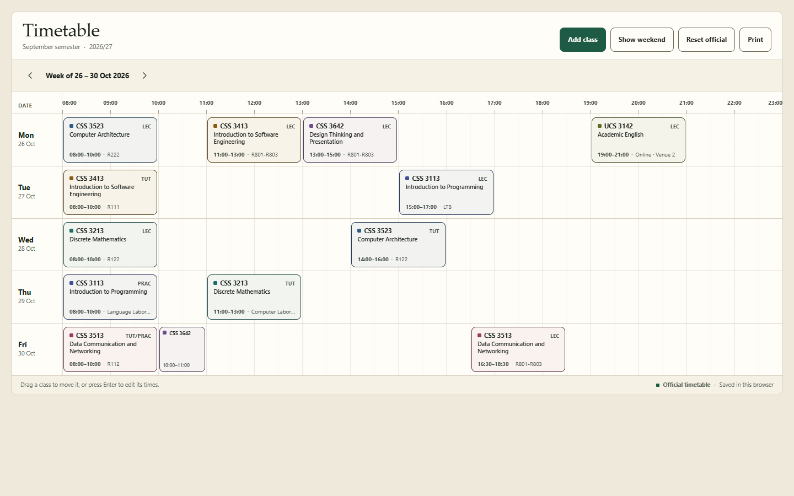

# Timetable

A weekly timetable for the September semester 2026/27 of a UTS degree.
Static HTML, CSS and JavaScript with no build step and no dependencies.

Live: https://nelstrooy28.github.io/timetable/

- **Laptop:** a 15-hour grid, Monday to Friday, with the weekend optional.
- **Phone:** the same week as a day-by-day agenda, because 15 hours of columns
  cannot be read at 375px.
- Moves, edits, additions and deletions are saved in the browser.
- **Print** gives an A4 landscape sheet.



## Structure

| File | Purpose |
| --- | --- |
| `index.html` | Markup, the two dialogs, the toast |
| `css/style.css` | Design tokens, grid and agenda layouts, print rules |
| `js/data.js` | Semester metadata, courses, the 13 official classes |
| `js/app.js` | State, rendering, drag and drop, persistence |
| `DESIGN.md` | Design direction, palette and type reasoning |

## Running it

Open `index.html` directly, or serve the folder:

```
python -m http.server 8000
```

## Data

The 13 classes were transcribed from UTS TimetableHub on 23 October 2026. The
timetable repeats every week, so the week navigation moves the dates rather than
the classes.

Edits live in this browser only, under the key
`uts-timetable.2026-27SEP.v1`. Nothing is sent anywhere, and
"Reset official" restores the downloaded timetable.
